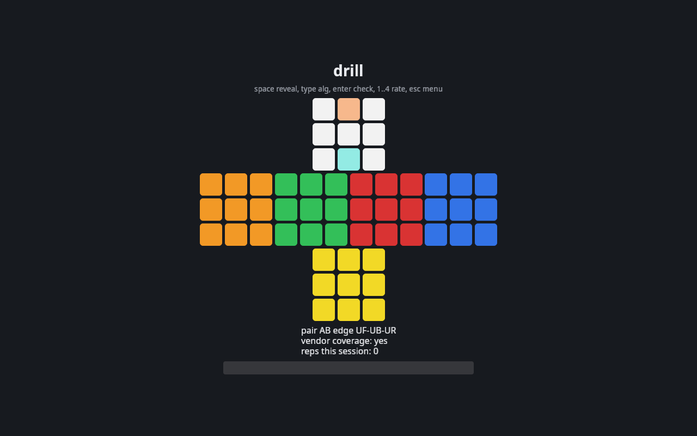
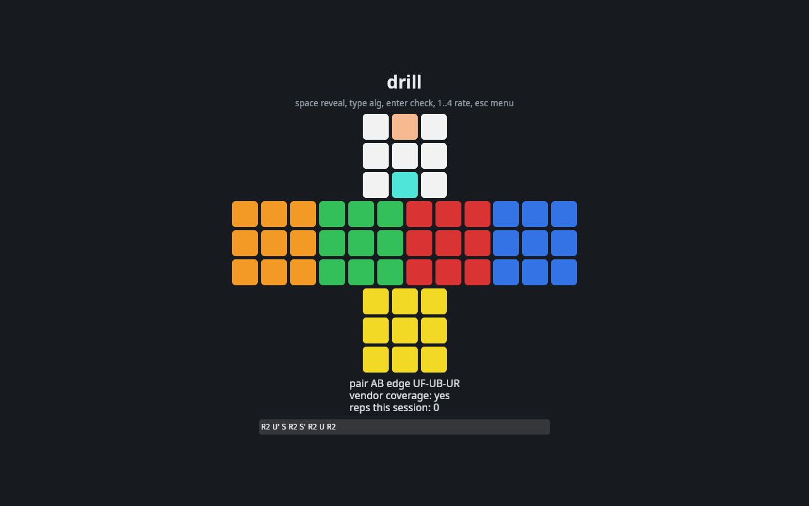
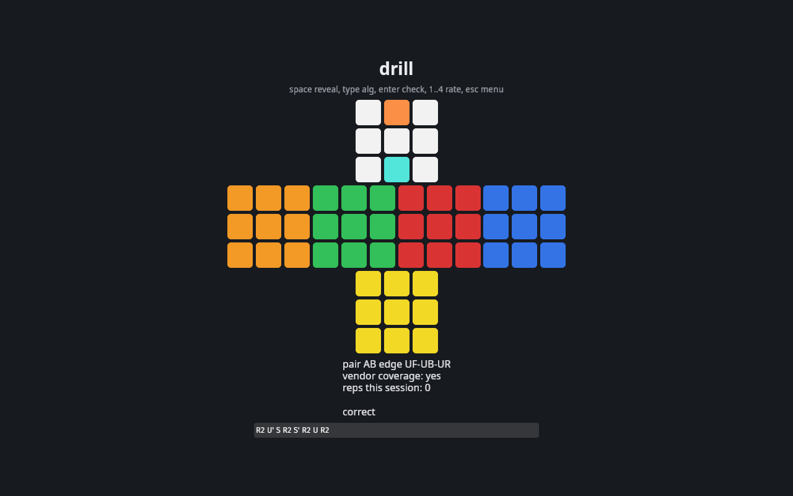
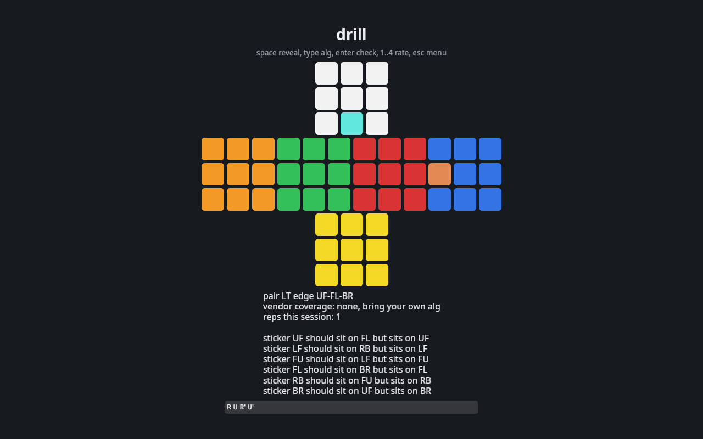
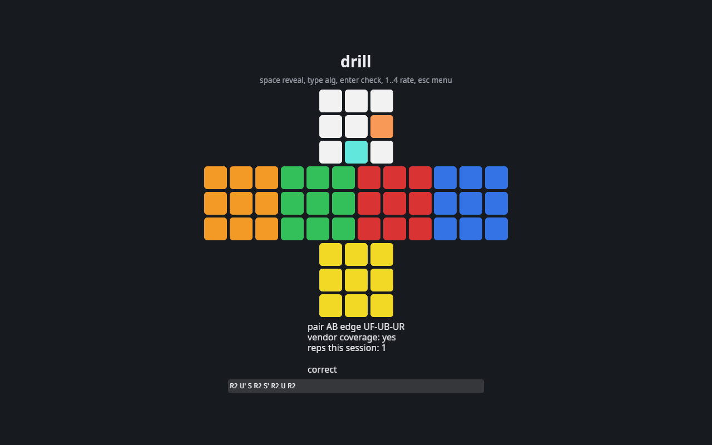

# blind trainer

A desktop 3BLD trainer: 3-style drilling, memo training, and timed solves. Every alg is mechanically verified against an emulated cube, so misspellings and wrong algs never contaminate muscle memory. Grounding data is the reconstructed alg sets of Tommy Cherry and Charlie Eggins, sha-256 pinned under local ref_ground/.

## architecture

Rust workspace. Arrows point from dependent to dependency:

```
bt-core
  <- bt-scheme
       <- bt-data
            <- bt-app
            <- bt-gendata
            <- bt-verify (also depends on bt-scheme)
       <- bt-ga
            <- bt-ga-run
       <- bt-memofreq
bt-visual-diff (no crate dependencies)
```

- bt-core: cube model, precomputed move permutations, siGN notation dialect parse/format/inverse/qtm, piece and orientation analysis. std only.
- bt-scheme: Speffz letter maps, floating-buffer pair spaces, classifier mirroring the blddb tracer, memo generator, seeded scrambles.
- bt-data: TSV corpus loader, alg verification verdicts, SM-2 spaced repetition, user-dir overlay.
- bt-ga: Vietnamese syllable inventory, perceptual features, genetic assignment optimizer. bt-app consumes its JSON output and never depends on the crate.
- bt-app: Bevy desktop app shipped as blind-trainer.exe, keyboard-first UI, JSON persistence in the user dir. AppLogicPlugin carries all game flow with no rendering, PresentationPlugin owns the UI, so headless e2e drives complete flows through MinimalPlugins.
- tools: bt-gendata builds data/vendor from ref_ground/, bt-verify writes the alg verification report, bt-memofreq runs the memo frequency Monte Carlo, bt-ga-run runs the optimizer into data/ga/, bt-visual-diff compares screenshots against committed baselines.
- fuzz/: cargo-fuzz targets, excluded from the workspace.

## cube model

Sticker id = face*4 + position within face. Corners 0..23, edges 24..47, centers 48..53. Face order U L F R B D, each face a 2x2 grid numbered row-major:

```
U: 0 1     L: 4 5     F: 8 9     R: 12 13    B: 16 17    D: 20 21
   2 3        6 7        10 11      14 15       18 19       22 23
edges: UB=24 UR=25 UF=26 UL=27 LU=28 ... DL=47 (orbit order follows the Speffz table)
```

Cube state is `occ: [u8; 54]` where occ[i] is the home sticker id currently at position i. The inverse state is the transpose: inverse[i] = position of home sticker i. Solved means occ[i] == i for all i. Speffz anchors: edge UF is sticker 26 letter C, corner UFR is sticker 2 letter C, the full map is equality-tested against ref_ground/position_map.tsv.

## notation

siGN dialect: faces U D L R F B with ' and 2, lowercase wides, inner slices 2U 2D 2L 2R 2F 2B, slices M E S, rotations x y z. M follows L, E follows D, S follows F. Rotation pins: z = F S B', x = R M' L', y = U E' D'. M2' canonicalizes to M2 because both produce the same permutation. Only face turns keep centers fixed, wides, inners, slices, and rotations move them, which is what makes centers_fixed a meaningful predicate. Every vendor alg in ref_ground is center-fixed by cancellation.

## execution model

3-style with floating-buffer sticker-following execution. Edge buffer UF, corner buffer UFR. Floating order: edges UF UB UR UL FR FL DF DB DR DL BR BL, corners UFR UFL UBR UBL DFR DFL DBR DBL. A case written A-B-C cycles sticker A to B, B to C, C to A (CYCLE_A direction, verified on all 988 vendor 3-style rows). The first position token of a vendor alg names the floating buffer the alg starts from, which is how later memo pairs execute at non-UF/UFR buffers: memo generation records each pair's floating buffer head, and the ideal cycle oracle takes that buffer as an argument. Defects: which pieces an alg flips or twists is read from the simcheck notes produced by the independent pysim simulator, never inferred from position tokens, the two derivations disagree on 213 of 1077 rows.

## usage

### first run

make gen-data builds data/vendor from ref_ground/, make run starts blind-trainer.exe. All user data persists as JSON in the user dir: %APPDATA%/blind-trainer on Windows, ~/.local/share/blind-trainer otherwise ($XDG_DATA_HOME/blind-trainer when the variable is set), split into settings, srs, solves, and the user alg overlay. make screenshots regenerates every image below, timers and streamed counts reflect the capture run so images differ slightly between runs.

### menu

Digits 1 to 6 open the views, esc returns to the menu from every view and first drops any focused text input.


### drill

3-style pair drilling with mechanical verification and SM-2 scheduling. space starts the alg phase and focuses the input, the net highlights the buffer plus one target sticker and swaps to the other target every 0.6 seconds. Type the alg, enter verifies it on the emulated cube: a wrong alg comes back with named problems, it never passes. 1 to 4 rate the rep (again, hard, good, easy) into SM-2, space pulls the next case with due and uncovered pairs first.



The input phase with the alg typed in:



A verified alg:



A wrong alg rejected with named problems:



After rating, space loads the next case:



### memo training

Streaming memo on seeded scrambles. Intro shows the pair count, space starts the stream, syllables appear at the configured cadence, image mode flashes an English word for 620 of the 818 pairs and falls back to the bare letters for the rest. When the stream ends the app asks you to recall, space reveals the full memo with its residue lines (parity, flips, twists). r replays the stream, 1 to 4 rate every streamed pair into SM-2, space moves to the next scramble.


Mid stream:


Recall prompt after the last syllable:


Full memo with residue lines:


### solve

The timed full cycle. Ready shows the scramble seed and pair count, space starts the memo clock, syllables stream while the memo timer runs. space again switches to execution, space stops everything. The app replays your memo against the vendor corpus on the emulated cube, reports solved or failed with the broken pairs, and logs the record with memo, exec, and total splits. space starts the next scramble.


Memo phase with timer and stream counter:


Execution phase:


Result with splits:


### algs

Browser over the full 818 pair space. Slash focuses the filter, typed letters filter the list, up down always move the selection, n p and d work when the filter is not focused, esc drops the filter focus first and exits the view on the second press. Each row lists solver, alg, qtm and htm lengths, a verification badge, the commutator, and links.


Filtered to b with the selection moved:


### stats

Aggregates over the solve log and srs store: solve count, memo and exec mean and median, due counts per orbit, and the trailing streak of successful reviews.


### settings

Memo cadence, memo mode (syllables or images), and drill reps. The number inputs and the select apply immediately, 1 and 2 switch the memo mode from the keyboard, everything persists across restarts.


### fatal

If the config cannot be read, or the vendor directory exists but its sheets are unreadable, the app opens here with the reason instead of the menu. A missing vendor directory only warns at the menu and the app runs on user data alone. The fatal screen ignores keys, fix the reported path and restart.


## runtime notes

Bevy 0.20 with bevy_feathers. The bevy facade needs the custom_cursor feature enabled alongside bevy_feathers, without it bevy_winit 0.20.0 fails to build from feature skew. The release binary resolves assets through an absolute AssetPlugin file_path built at startup, the default asset root is exe-relative and wrong for installed layouts. Text input uses the shipped FeathersTextInput, no custom widget.

## host tooling

cargo-fuzz 0.13.2 with the nightly MSVC toolchain, targets notation, classify, memo under fuzz/fuzz/ (nested project layout, nearest-ancestor Cargo.toml resolution). Two PATH requirements when a standalone stable Rust install exists on the machine: the rustup proxy dir (~/.cargo/bin) must precede the standalone bin dir or every toolchain pin (fuzz/rust-toolchain.toml, RUSTUP_TOOLCHAIN) is bypassed and the build rejects -Z flags, and the MSVC ASan runtime dir (VC\Tools\MSVC\<ver>\bin\Hostx64\x64 holding clang_rt.asan_dynamic-x86_64.dll) must be on PATH or the built fuzz binaries die with STATUS_DLL_NOT_FOUND. cargo-mutants 27.1.0, configured in .cargo/mutants.toml with gitignore=false so scratch copies keep ref_ground reachable through relative env paths, run with scratch-local targets (no CARGO_TARGET_DIR) which need roughly 10 GB of free disk. Both tools compile nothing from bt-app.

## make targets

- setup: ensure rustfmt and clippy components, report cargo-fuzz and cargo-mutants availability.
- docs-fetch: snapshot reference docs into ref_doc/ via scripts/fetch_docs.ps1.
- gen-data: build data/vendor from ref_ground/.
- verify-algs: verify every vendor alg against the emulated cube, write the report.
- memofreq: Monte Carlo memo pair frequencies.
- ga: run the syllable GA into data/ga/.
- fmt: cargo fmt --all -- --check.
- lint: cargo clippy --workspace --all-targets -- -D warnings.
- check: cargo check --workspace.
- test: cargo test --workspace.
- build: release build of bt-app, asserts target/release/blind-trainer.exe exists.
- fuzz: cargo fuzz run over the notation, classify, memo targets in fuzz/.
- mutation: cargo mutants over bt-core, bt-scheme, bt-data, bt-ga.
- e2e: headless flow suite (cargo test --release -p bt-app --test e2e) plus windowed blind-trainer.exe --smoke writing screenshots to artifacts/e2e.
- visual: bt-visual-diff over artifacts/e2e versus tests/visual/baselines.
- screenshots: drive the windowed app through every usage state into docs/screenshots, fatal state included.
- run: cargo run --release -p bt-app.
- chain: test, fmt, lint, check, build, fuzz, mutation, e2e, visual, verify-algs, each as a separate make invocation so a failure names its step.

## config hub

config/config.json is the single centralized hub for every tunable: app window and memo cadence, ga seed and weights, memofreq sampling, srs intervals, verify limits, fuzz budgets, and all paths. No constant lives anywhere else. The Makefile exports the path roots as BT_REF_GROUND, BT_CONFIG, and BT_ARTIFACTS so binaries resolve ref_ground/, config/config.json, and artifacts/ from the environment.

## development

Verification chain, run through make chain and committed at each green step: test, fmt, lint, check, build, fuzz, mutation, e2e, visual, verify-algs. Baseline-first TDD per milestone, property-based invariants where they pay off, adversarial review by two independent agents before any task closes. Conventional commits, zero code comments, max 1000 SLOC per file.

## licensing

Repository code is MIT. ref_ground/ and ref_doc/ are gitignored local grounding derived from GPL-3.0 blddb exports, see DATA_PROVENANCE.md for hashes, retrieval dates, and regeneration steps.
