# blind trainer

[](https://github.com/lavantien/blind-trainer/actions/workflows/ci.yml)
[](scripts/coverage-badge.ps1)
[](scripts/alg-coverage-badge.ps1)

A desktop 3BLD trainer: 3-style drilling, memo training, and timed solves, plus a multi-event alg repository covering CFOP, OH, 2x2, big cubes 4x4 to 7x7, pyraminx, megaminx, skewb, square-1, and FTO, every case drilled under the same FSRS-5 scheduler. Every alg is mechanically verified against an emulated cube or its own event engine, so misspellings and wrong algs never contaminate muscle memory. Grounding data is the reconstructed alg sets of Tommy Cherry and Charlie Eggins plus provenance-tagged seed packs, sha-256 pinned under ref_ground/.

## usage

### first run

make gen-data builds data/vendor from ref_ground/, make run starts blind-trainer.exe. All user data persists in blind-trainer.db, a SQLite database in the user dir: %APPDATA%/blind-trainer on Windows, ~/.local/share/blind-trainer otherwise ($XDG_DATA_HOME/blind-trainer when the variable is set). Schema changes run as numbered migrations from db/migrations/, each step copies the database to a .bak backup first, and legacy JSON files (settings, srs, solves, user alg overlay) import once on first run and rename to .migrated. make screenshots regenerates every image below, timers and streamed counts reflect the capture run so images differ slightly between runs.

### menu

Digits 1 to 6 open the views. Every row shows the view name with a one-line description, boot warnings such as a missing vendor directory appear in the header strip. esc returns to the menu from every view and first drops any focused text input.

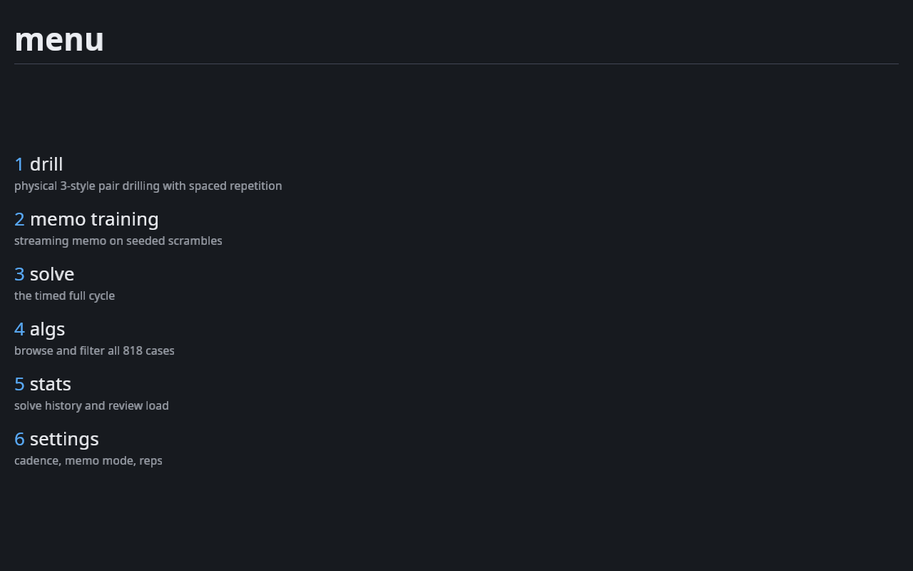

### drill

Physical 3-style pair drilling with FSRS-5 scheduling, no typed input anywhere: every alg shown is verified against the emulated cube at corpus build time. The net sits on the left with the buffer and both target stickers highlighted, the card on the right.

The card shows the pair letters, orbit and position, the memo token (edges use the Vietnamese syllable, corners the image word, bare letters when uncovered), the side A alg colored by mechanic with setup muted, insertion teal, interchange orange, falling back to the raw commutator when it does not decompose, the prepare line holding side B, the vendor alg of the flipped case or the derived inverse labeled inverse, plus qtm and htm lengths, solver, verified badge, FSRS due for both sides, and muted alternative vendor rows.

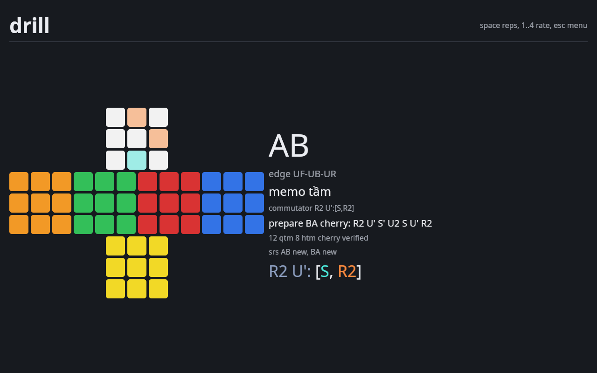

Apply prepare to your solved cube, space starts the rep phase. The net mirrors the physical cube from the prepared state, each space executes the shown alg, records a split, and flips to the other side, alternating A and B until the even rep count (drill reps rounded up, minimum 2, default 6) ends back in the prepared state. The timer shows whole seconds.

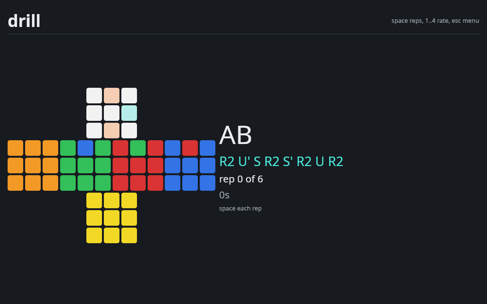

Rate AB then BA with 1 to 4 (again, hard, good, easy), each rating writes FSRS for its own position and the next covered pair loads automatically, due or new pairs first. esc aborts to the menu writing nothing.


The second prompt:

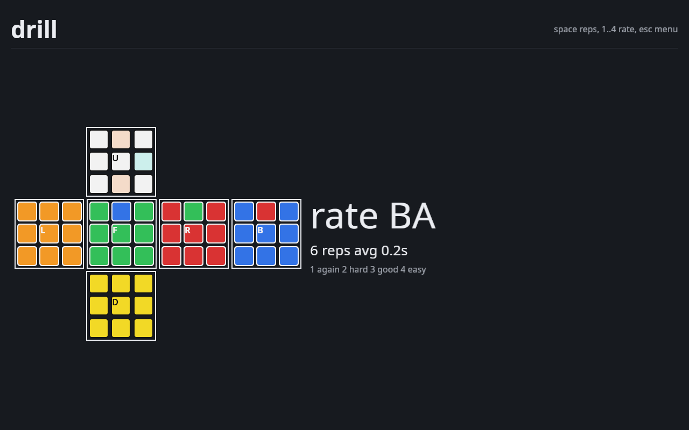

### memo training

Streaming memo on seeded scrambles with per-orbit tokens by default: edges stream Vietnamese syllables, corners stream image words, both fall back to the bare letters. Intro shows the seed, pair count, mode, and cadence, space starts the stream. The current token renders focal with the 4 previous tokens muted below it and a stream counter. When the stream ends the app asks you to recall with no tokens shown, space reveals the full memo with its residue lines (parity, flips, twists). r replays the stream, 1 to 4 rate every streamed pair into FSRS, space moves to the next scramble.

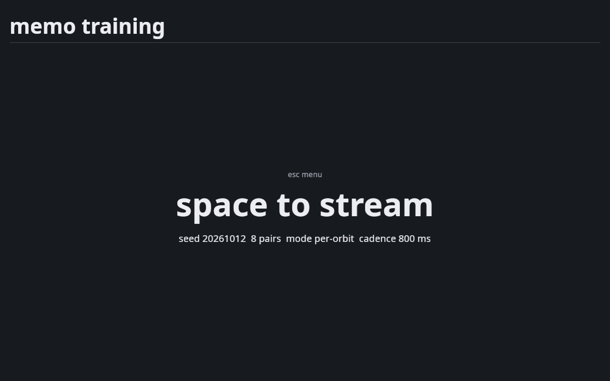

Mid stream:

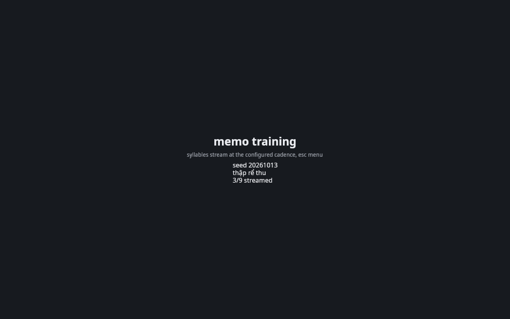

The recall prompt hides every token:


Full memo with residue lines:

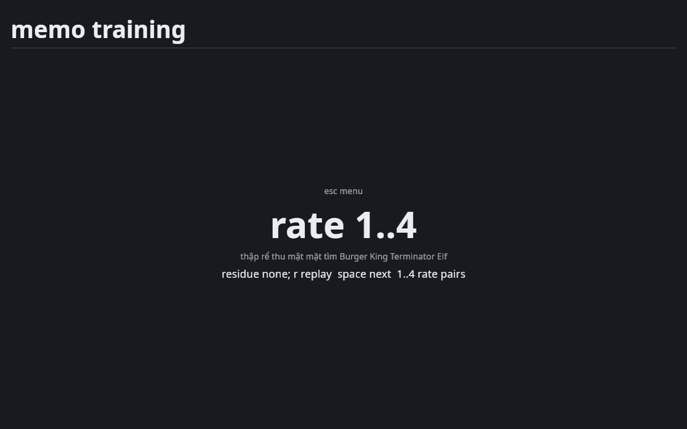

### solve

The timed full cycle with the net on the left and a rail on the right. Ready shows the scramble seed and pair count, space starts the memo clock and the token stream with a focal counter, space again switches to execution, space stops everything. The app replays your memo against the vendor corpus on the emulated cube, reports solved or failed with the broken pairs, and logs the record with memo, exec, and total splits. space starts the next scramble.

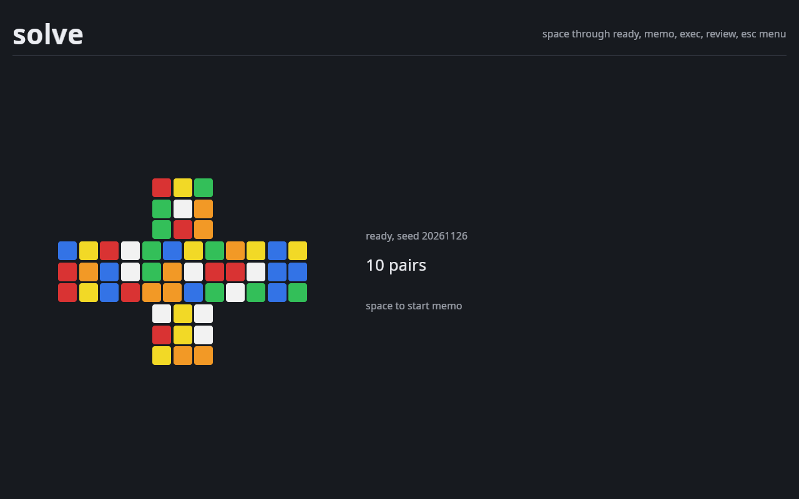

Memo phase with timer and stream counter:

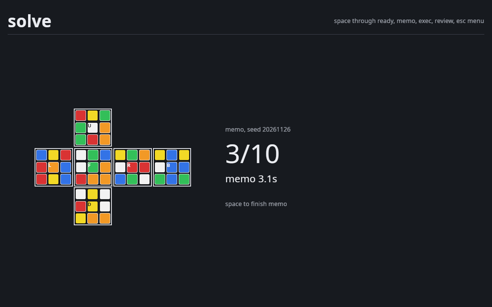

Execution phase:

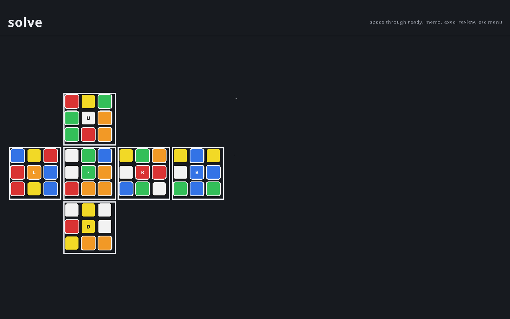

Result with splits:

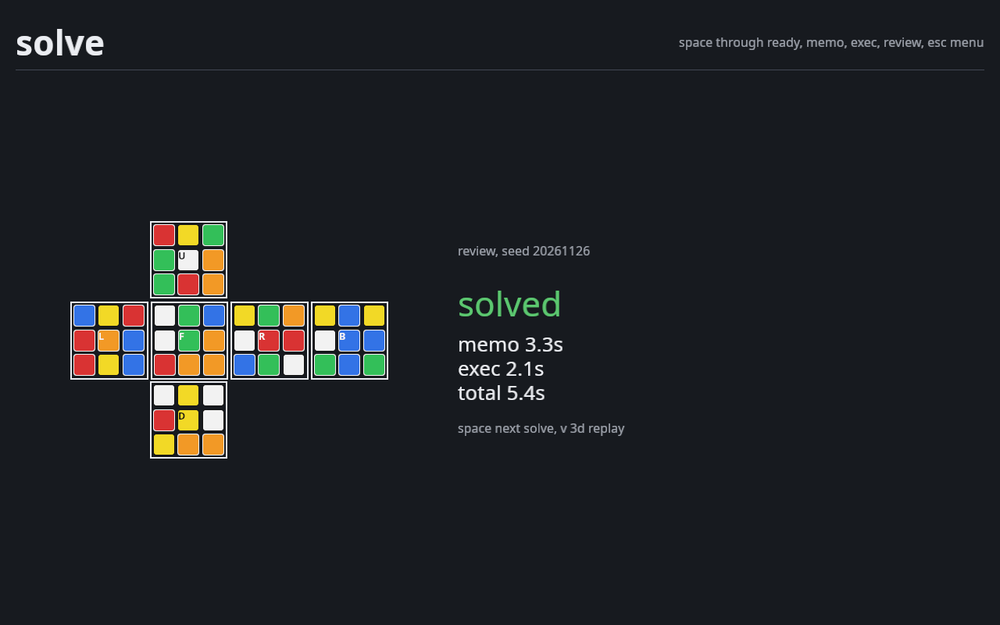

### replay

v at the solve review replays your solve as an animated 3d cube, the executed memo sequence turning on the scramble. Hold any mouse button and drag to orbit, the wheel zooms, r resets the camera, space pauses and resumes playback, v returns to the solve. Playback speed and the camera defaults and clamps live in the app.replay config section.

### algs

Two-column browser over the full 818 pair space plus the multi-event repository: the windowed list sits left, the selected case right. The list starts at the 3BLD letters, then one arm per event from the seed registry: 2x2, skewb, pyraminx, megaminx, square-1, big cube split by size 4x4 to 7x7, FTO, 3x3, and OH, each nesting method, stage, then cases from its seeded pack. An event whose pack fails to load hides with a boot warning instead of breaking the catalog.

At the letters, slash focuses the filter and typed letters filter by pair prefix. Up down and n p move the selection everywhere, right descends into a repository node, left ascends, d or enter sends a 3BLD case to the drill or arms the case drill at a repository node. esc drops the filter focus first and exits the view on the second press. The 3BLD detail shows the letters, orbit, position, and coverage, the first vendor alg colored by mechanic when its commutator decomposes, alternative algs, solver, qtm and htm lengths, a verification badge, and recon and video links. A repository case shows its event, method, stage, the net rendered through that event's engine, the seed alg with a seed or override badge, and a tier 1 verification line.

Seed algs can be overridden per case: o opens a draft prefilled with the effective alg, enter submits it through the event's tier 1 verifier so a broken override never lands, tab cancels, x deletes the override and reverts to the seed.

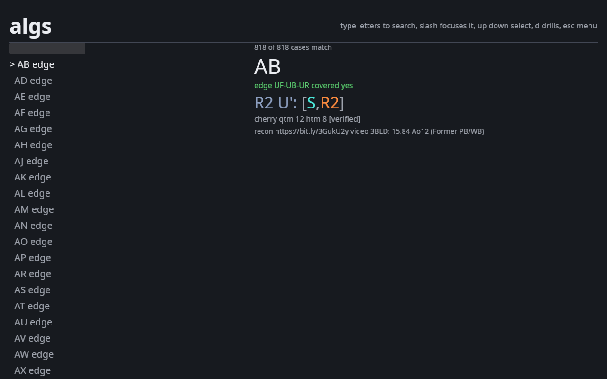

Filtered to b with the selection moved:

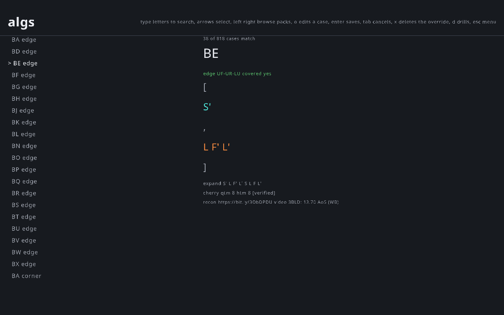

### case drill

d at a repository node arms a due session over every case under that node, d at a case node drills that single case. The session orders due and new cards first, space reveals the case, 1 to 4 grade again, hard, good, easy into FSRS with the case card repo, and the next card loads automatically until the queue empties and returns to the browser. esc exits to the menu at any time. 3BLD keeps its own drill view, the case drill serves every other event.

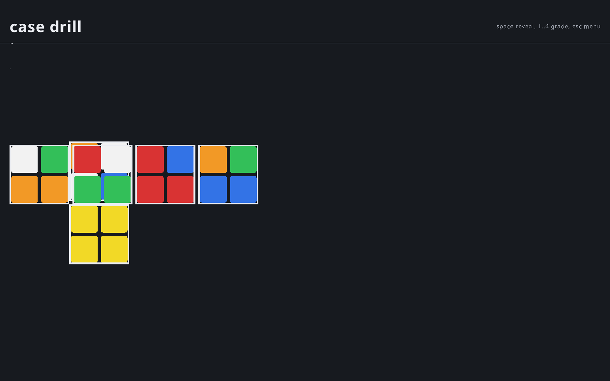

Grading:


### stats

A block grid over the solve log and both card stores: solve count, trailing streak of successful reviews, memo and exec mean and median, due counts per orbit for 3BLD, and a due count per event that holds case cards, so the session load reads at a glance.

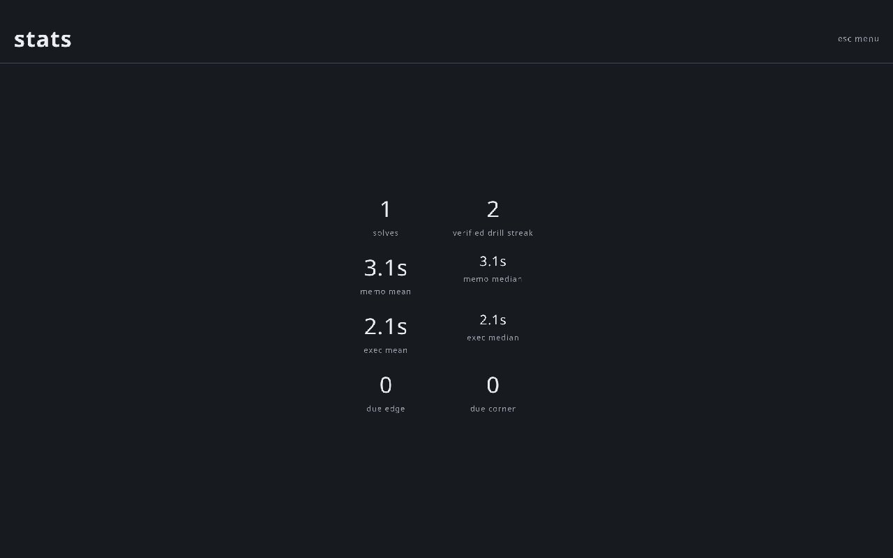

### settings

Memo cadence, memo mode (syllables, images, or per-orbit, the default), and drill reps. The number inputs and the select apply immediately, 1 2 and 3 switch the memo mode from the keyboard when no input is focused, everything persists across restarts.

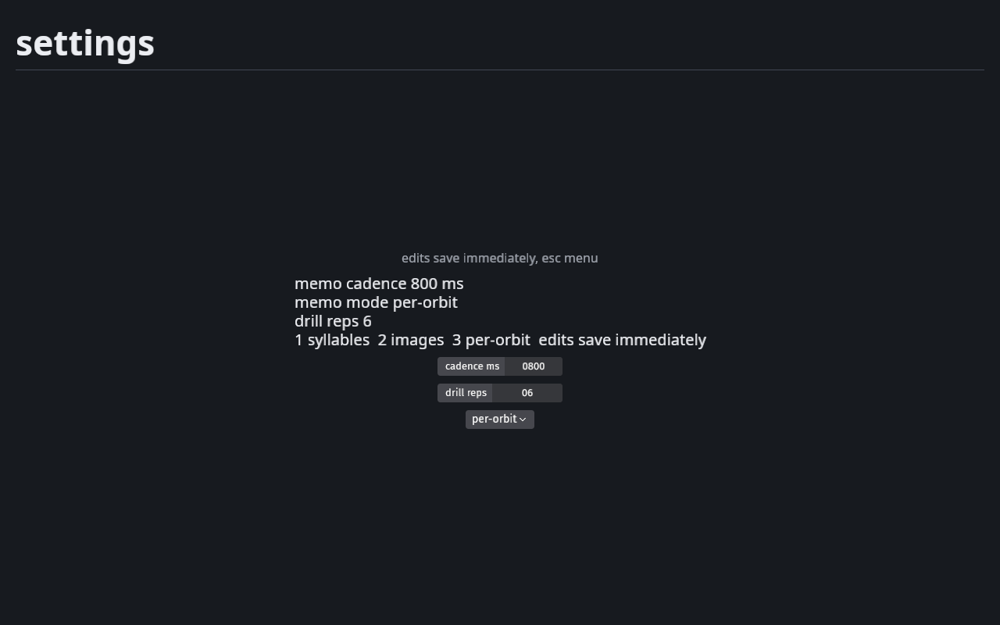

### fatal

If the config cannot be read, or the vendor directory exists but its sheets are unreadable, the app opens here with the reason instead of the menu. A missing vendor directory only warns at the menu and the app runs on user data alone. The fatal screen ignores keys, fix the reported path and restart.

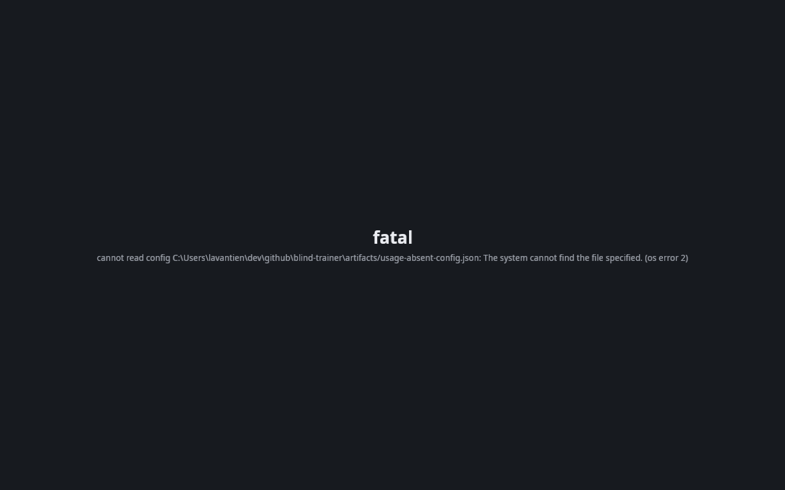

## schemes

### letters

Speffz letter scheme, one letter per sticker position per orbit, A through X:

```
edges   A UB  B UR  C UF  D UL  E LU  F LF  G LD  H LB
        I FU  J FR  K FD  L FL  M RU  N RB  O RD  P RF
        Q BU  R BL  S BD  T BR  U DF  V DR  W DB  X DL
corners A UBL B UBR C UFR D UFL E LUB F LUF G LDF H LDB
        I FUL J FUR K FDR L FDL M RUF N RUB O RDB P RDF
        Q BUR R BUL S BDL T BDR U DFL V DFR W DBR X DBL
```

The full map is equality-tested against ref_ground/position_map.tsv.

### colors

White up, green front, red right, blue back, orange left, yellow down. The net lays out U on top, L F R B across the middle band with F centered, D at the bottom, faces identified by color. Every face plate carries a frame outline and every sticker a thin stroke whose ink is picked by luminance against the sticker color, so faces and stickers read clearly through the buffer and target highlights.

### buffers

Edge buffer UF, corner buffer UFR, both letter C. When the buffer piece itself gets displaced the buffer floats: edges follow UF UB UR UL FR FL DF DB DR DL BR BL, corners follow UFR UFL UBR UBL DFR DFL DBR DBL.

### memo tokens

Edge pairs memo as single Vietnamese syllables from data/ga/syllables.json, one syllable per pair, assigned by the genetic optimizer under memo-frequency weighting, make ga regenerates the assignment. Corner pairs memo as image words from the 620-entry letter-pair table embedded in bt-app, AB is Anthony Brooks, QM is Quail Man, pairs without an entry fall back to the bare letters. The memo mode setting picks the stream: syllables, images, or per-orbit, the default, syllables for edges and image words for corners.

### synthesis

Pairs with no vendor alg get a synthesized commutator from bt-gendata. Candidates are scored for fingertrick feel: move count, a penalty for turns outside the preferred face set, regrip count, and per-face finger costs that price each turn by direction, every weight a knob in the synth.scoring hub section. The search stops at the first setup depth that produces a hit and ranks only candidates at or under that length plateau. Regeneration short-circuits when nothing changed: a sha over the synth parameters, the corpus digest, and a generator version token skips synthesis outright.

### scheduling

FSRS-5 spaced repetition schedules every drilled position separately. Ratings 1 to 4 map to again, hard, good, easy, stability and difficulty follow the pinned py-fsrs 5.1.3 reference math, intervals clamp to 1..365 days from the config hub. The 19 weights default to the reference release and live in srs.fsrs with the request retention, golden vectors generated from py-fsrs 5.1.3 pin the math under ref_ground/fsrs, and the fuzz fsrs target walks the scheduler. Legacy SM-2 history migrated by deterministic replay when migration 002 dropped the ease column.

## cube model

Sticker id = face*4 + position within face. Corners 0..23, edges 24..47, centers 48..53. Face order U L F R B D, each face a 2x2 grid numbered row-major:

```
U: 0 1     L: 4 5     F: 8 9     R: 12 13    B: 16 17    D: 20 21
   2 3        6 7        10 11      14 15       18 19       22 23
edges: UB=24 UR=25 UF=26 UL=27 LU=28 ... DL=47 (orbit order follows the Speffz table)
```

Cube state is `occ: [u8; 54]` where occ[i] is the home sticker id currently at position i. The inverse state is the transpose: inverse[i] = position of home sticker i. Solved means occ[i] == i for all i. Speffz anchors: edge UF is sticker 26 letter C, corner UFR is sticker 2 letter C, the full map is equality-tested against ref_ground/position_map.tsv.

## notation

siGN dialect: faces U D L R F B with ' and 2, lowercase wides, inner slices 2U 2D 2L 2R 2F 2B, slices M E S, rotations x y z. M follows L, E follows D, S follows F. Rotation pins: z = F S B', x = R M' L', y = U E' D'. M2' canonicalizes to M2 because both produce the same permutation. Only face turns keep centers fixed, wides, inners, slices, and rotations move them, which is what makes centers_fixed a meaningful predicate. Every vendor alg in ref_ground is center-fixed by cancellation.

## execution model

3-style with floating-buffer sticker-following execution. Edge buffer UF, corner buffer UFR, floating orders listed under schemes. A case written A-B-C cycles sticker A to B, B to C, C to A (CYCLE_A direction, verified on all 988 vendor 3-style rows). The first position token of a vendor alg names the floating buffer the alg starts from, which is how later memo pairs execute at non-UF/UFR buffers: memo generation records each pair's floating buffer head, and the ideal cycle oracle takes that buffer as an argument. Defects: which pieces an alg flips or twists is read from the simcheck notes produced by the independent pysim simulator, never inferred from position tokens, the two derivations disagree on 213 of 1077 rows.

## event engines and pack verification

Every non-3BLD event runs on its own engine in bt-puzzles: nxn handles 2x2 through 7x7 under one stride-based model, sq1 carries the exact square-1 geometry with the state-aware slash, mega the 5-sided ring under the pack's pinned grammar, pyra the regs 12e facelet model, skewb the corner-on turn tables, fto all 8 faces of the octahedron. Each engine parses its event's notation dialect and applies moves to its own state, one module per event behind a shared geometry seam.

Pack rows verify under a two tier model. Tier 1 round trips the row's alg against its inverse from solved in both orders through its event engine, so tokens that do not parse, sequences that do not execute, and wrong algs all fail closed. Tier 2 checks an independent predicate over the resulting state where an honest one exists, the sq1 cubeshape rows compare against the canonical shape classifier and the bld oldpoch rows against a piece audit, and prints a skip reason where none exists, prose algs and letter scheme rows. Known source defects stay verbatim: 52 rows sit on the expected-failure table in bt-data with per-row reasons, the probes that ruled out repairable explanations are pinned as evidence tests, and the rulings live in ref_ground/packs/PROVENANCE.md. make verify-algs fails on any unruled failure, any ruled row that fails nothing (a stale ruling), and any row-count drift against the registry pins.

## architecture

Rust workspace, arrows run left to right from dependency to consumer:

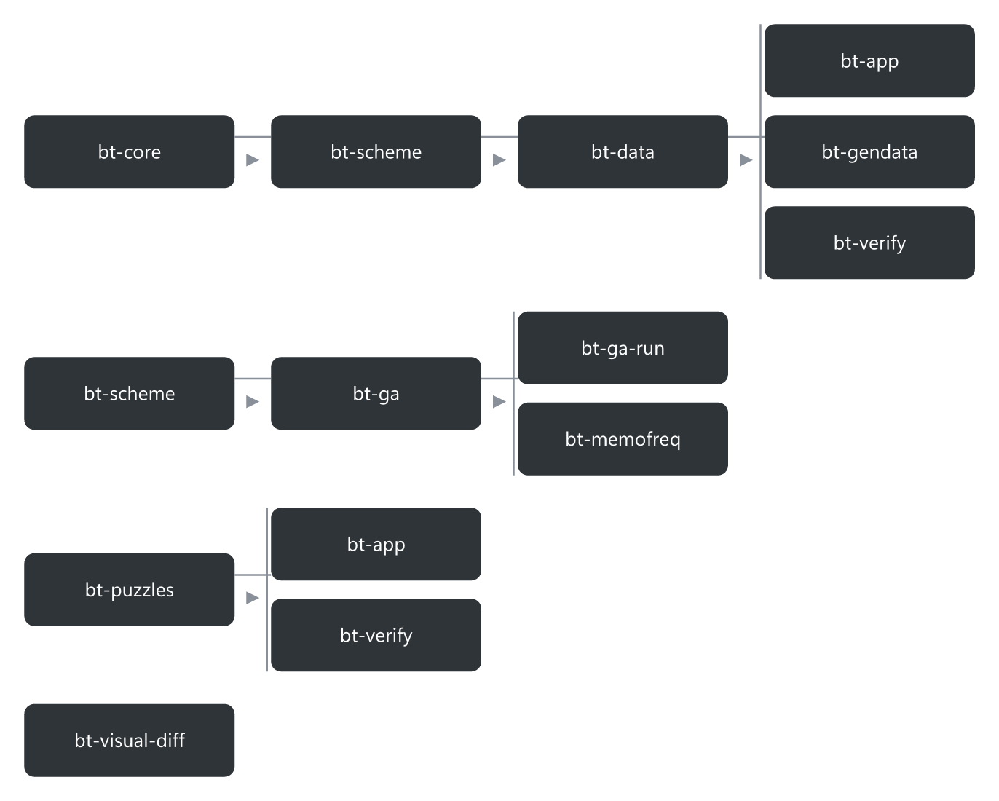

bt-ga also builds on bt-data, bt-app and bt-verify also on bt-puzzles, bt-verify also on bt-scheme and bt-gendata, bt-ga-run and bt-memofreq also on bt-data and bt-ga. bt-puzzles and bt-visual-diff have no crate dependencies.

- bt-core: cube model, precomputed move permutations, siGN notation dialect parse/format/inverse/qtm, piece and orientation analysis. std only.

  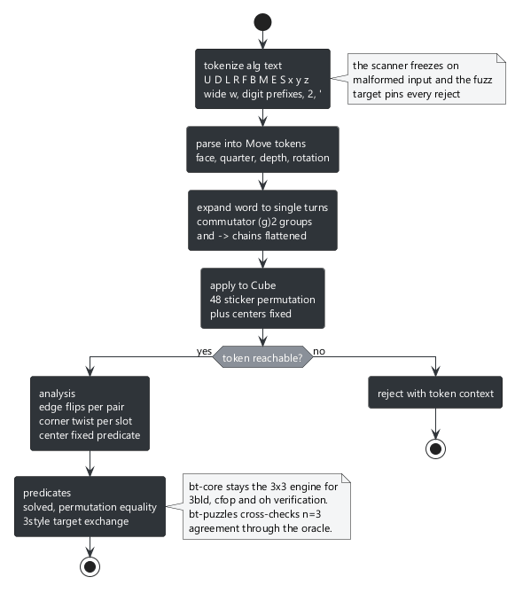

- bt-scheme: Speffz letter maps, floating-buffer pair spaces, classifier mirroring the blddb tracer, memo generator, seeded scrambles.

  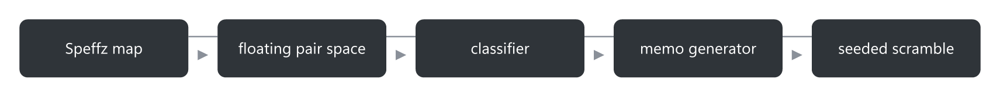

- bt-data: SQLite storage (migrations, .bak backup, one-time JSON import), TSV corpus loader, seed pack loader and normalizer, alg verification verdicts, FSRS-5 spaced repetition, all repositories behind the Stores interface.

  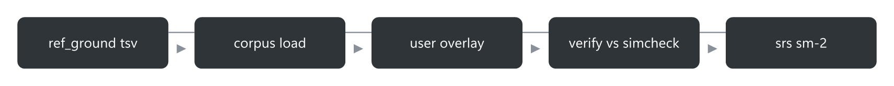

- bt-ga: Vietnamese syllable inventory, perceptual features, genetic assignment optimizer. bt-app consumes its JSON output and never depends on the crate.

  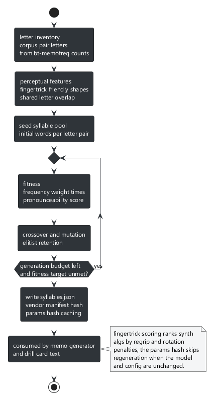

- bt-app: Bevy desktop app shipped as blind-trainer.exe, keyboard-first UI, SQLite persistence in the user dir. AppLogicPlugin carries all game flow with no rendering, PresentationPlugin owns the UI, so headless e2e drives complete flows through MinimalPlugins.

  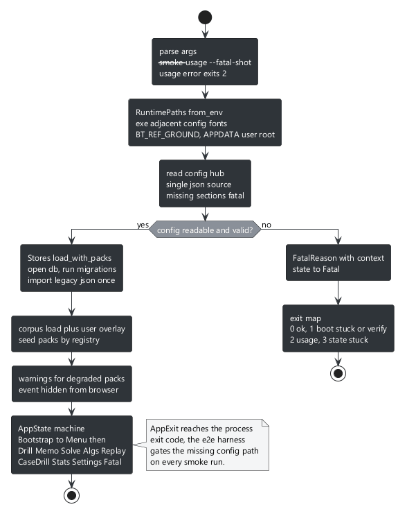

- bt-puzzles: one engine module per event (nxn, sq1, mega, pyra, skewb, fto) behind a shared geometry seam, plus the generic tier 1 verifier. std only, consumed by bt-verify and bt-app.

- tools: bt-gendata builds data/vendor from ref_ground/ and synthesizes verified commutator algs for every uncovered pair, bt-verify writes the alg verification report over the corpus and the event packs, bt-memofreq runs the memo frequency Monte Carlo, bt-ga-run runs the optimizer into data/ga/, bt-policy enforces the config hub and zero-comment rules, bt-mutants-gate gates mutation survivors against the allowlist, bt-release-verify byte-checks the dist zip and runs the packaged exe hermetically, bt-sleeper is the memguard fixture, bt-visual-diff compares screenshots against committed baselines.
- tests/e2e: bt-e2e drives the release exe through the smoke tour under a sandboxed APPDATA.
- fuzz/: cargo-fuzz targets, excluded from the workspace.

App flows, one per view cycle:


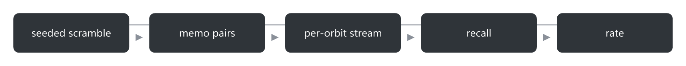

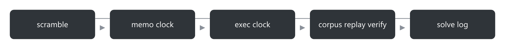

## runtime notes

Bevy with bevy_feathers. The bevy facade needs the custom_cursor feature enabled alongside bevy_feathers, without it bevy_winit fails to build from feature skew. Runtime roots for config, vendor data, and assets resolve from the workspace layout first and fall back to an exe-relative install layout when the workspace paths are missing, assets load through an absolute AssetPlugin file_path built at startup. Text input uses the shipped FeathersTextInput, no custom widget.

## host tooling

cargo-fuzz with the nightly MSVC toolchain, targets notation, classify, memo, commutator, db, and fsrs under fuzz/fuzz/ (nested project layout, nearest-ancestor Cargo.toml resolution). Two PATH requirements when a standalone stable Rust install exists on the machine: the rustup proxy dir (~/.cargo/bin) must precede the standalone bin dir or every toolchain pin (fuzz/rust-toolchain.toml, RUSTUP_TOOLCHAIN) is bypassed and the build rejects -Z flags, and the MSVC ASan runtime dir (VC\Tools\MSVC\<ver>\bin\Hostx64\x64 holding clang_rt.asan_dynamic-x86_64.dll) must be on PATH or the built fuzz binaries die with STATUS_DLL_NOT_FOUND. cargo-mutants, configured in .cargo/mutants.toml with gitignore=false so scratch copies keep ref_ground reachable through relative env paths, runs through make mutation over bt-core, bt-scheme, bt-data, bt-ga, and bt-puzzles with jobs 1 and scratch-local targets (the default, no CARGO_TARGET_DIR override). Operational rule: a cargo-mutants run never resumes, it rotates mutants.out.old and re-decides the full mutant listing fresh on every start, so an interrupted run restarts from zero and disk growth is never progress. A shared target dir is forbidden twice over: concurrent or cross-run sharing corrupts verdicts, and jobs above 1 are void for the same reason, and cached test binaries bake the absolute path of whichever scratch copy first built them, so every later run resolves ref_ground against a deleted scratch and the baseline fails. Each run pays a fresh build in its own scratch instead. Both tools compile nothing from bt-app.

## make targets

- setup: ensure rustfmt and clippy components, report cargo-fuzz and cargo-mutants availability.
- docs-fetch: snapshot reference docs into ref_doc/ via scripts/fetch_docs.ps1.
- gen-data: build data/vendor from ref_ground/, then synthesize and verify commutator algs for uncovered pairs (knobs in the synth config section, skips when the params hash is unchanged).
- synth-simcheck: run the independent pysim simulator over the synthesized algs, writing the simcheck notes the corpus defect reads come from.
- verify-algs: verify every vendor alg against the emulated cube and every pack row through its event engine, write the report.
- memofreq: Monte Carlo memo pair frequencies.
- ga: run the syllable GA into data/ga/.
- coverage: run cargo llvm-cov over the workspace into a private target dir and regenerate docs/badges/coverage.svg via scripts/coverage-badge.ps1.
- alg-coverage: regenerate docs/badges/alg-coverage.svg from data/vendor/manifest.json via scripts/alg-coverage-badge.ps1.
- diagrams: render every docs/diagrams png from its docs/diagrams/*.puml source via scripts/diagrams.ps1 and plantuml.
- fmt: cargo fmt --all -- --check.
- fmt-fix: cargo fmt --all in place.
- lint: cargo clippy --workspace --all-targets -- -D warnings.
- policy: run policy-selftest, then bt-policy over every source: zero comments everywhere, recurring numeric literals outside the config hub only when allowlisted in tools/bt-policy/constants_allow.txt with a justification.
- policy-selftest: planted fixtures prove bt-policy detects comments and recurring constants in both directions.
- check: cargo check --workspace.
- test: cargo test --workspace.
- test-crate: cargo test for one crate, usage make test-crate p=<crate>.
- build: release build of bt-app, asserts target/release/blind-trainer.exe exists.
- fuzz: cargo fuzz run over the notation, classify, memo, commutator, db, and fsrs targets in fuzz/.
- mutation: cargo mutants with jobs 1 and scratch-local targets over bt-core, bt-scheme, bt-data, bt-ga, and bt-puzzles, a run never resumes.
- mutants-gate: every Missed or Timeout mutant in mutants.out/outcomes.json must match a justified row in tools/bt-mutants-gate/allowlist.tsv, stale rows also fail. mutants-gate-selftest runs its unit suite.
- verify-algs-selftest: the bt-verify unit suite including the planted-offender detection test.
- e2e: headless flow suite (cargo test --release -p bt-app --test e2e) then e2e-smoke.
- e2e-smoke: bt-e2e drives the release exe through --smoke with APPDATA sandboxed to artifacts/e2e-user, asserting the shot list and window dims from the e2e config section, so the real user profile is never touched.
- baselines: copy the artifacts/e2e pngs into tests/visual/baselines, a deliberate out-of-chain refresh step, never run before visual since that would diff the run against itself.
- visual-selftest: synthetic pairs prove bt-visual-diff passes identical images and catches a one-pixel-over-tolerance drift.
- visual-diff: bt-visual-diff over artifacts/e2e versus tests/visual/baselines.
- visual: visual-selftest, then the diff; on a mismatch it re-renders and re-diffs once, exit 2 regression, exit 3 infra flake that passed the second diff, exit 4 infra error where the re-render itself failed, verdict appended to artifacts/visual/report.md.
- memguard: report the combined working set of every process whose executable lives under the repo against the memguard.cap_bytes hub cap, -Kill takes down the largest offender tree. -Wrap runs one payload anchored under a pidfile, the exe and args tokenized natively from a quote-aware string, no shell in the path. memguard-selftest proves the matcher with a repo sleeper and a command-line decoy.
- clean-rust: size the regenerable rust caches against the disk.free_floor_gb hub floor: incremental caches, cargo-mutants TEMP scratch dirs older than disk.scratch_stale_hours, external coverage and mutation targets, and the detached e2e and fuzz targets. clean-rust-apply deletes them in that order, deep clean of e2e and fuzz targets only when no cargo or rustc process is live (exit 3 refusal). clean-rust-selftest proves stale scratch selection and that a fresh active scratch survives.
- release-verify: byte-verify the dist zip against staging, then run the packaged exe hermetically (BT_* scrubbed, fresh APPDATA, foreign cwd) through the smoke tour twice (bare and with BT_CONFIG on the packaged config), then the negative paths: the extracted config deleted with BT_CONFIG pointing there asserting release.neg_config_exit, and a bare --smoke asserting release.usage_exit. release-verify-selftest runs its unit suite.
- dist: build, stage the zip at artifacts/dist via scripts/dist.ps1, then release-verify it, usage make dist v=<tag>.
- release: push main and the tag, publish the GitHub release with the zip, requires docs/releases/<tag>.md and the built zip.
- screenshots: drive the windowed app through every usage state into docs/screenshots, 19 usage shots plus the fatal screen.
- run: cargo run --release -p bt-app.
- clean: remove artifacts and tests/e2e/target, recreate artifacts.
- chain: test, fmt, lint, policy, check, build, fuzz, mutation, mutants-gate, e2e, visual, verify-algs, each as a separate make invocation so a failure names its step. visual always diffs fresh e2e renders against the committed baselines, baselines is never a chain leg.

## exit codes

blind-trainer.exe in smoke mode: 0 tour complete with all shots written, 1 verification failure or boot stuck past the limit, 2 CLI usage error, 3 a tour state never arrived. make visual: 0 clean, 2 regression on both diffs, 3 infra flake that passed the re-render, 4 infra error where the re-render itself failed. bt-visual-diff: 0 match, 1 mismatch or missing baseline, 2 usage. bt-e2e: 0 all shots verified, 1 shot failures, 2 harness error. memguard: 0 within cap, 2 usage or config error, 3 cap breach, 4 selftest fixture missing, 5 kill or assertion failure. bt-policy, bt-mutants-gate, bt-release-verify: 0 pass, 1 findings, 2 usage or harness error.

## config hub

config/config.json is the single centralized hub for every tunable: the app section (window, memo cadence and mode, drill reps, smoke seed, and the app.replay playback and camera knobs), ga seed and weights, memofreq sampling, srs.fsrs (the 19 FSRS-5 weights, request retention, interval clamp), verify limits, synth including synth.scoring (preferred faces, finger costs, and the ranking weights), visual tolerance, fuzz budgets, policy scanner settings, the memguard cap, the disk floor and scratch staleness window, the e2e shot list and timeout, the release verifier contract, and all paths including paths.packs. No constant lives anywhere else, and make policy enforces it: numeric literals recurring in src outside the hub must carry a justified row in tools/bt-policy/constants_allow.txt. The Makefile exports the path roots as BT_REF_GROUND, BT_CONFIG, and BT_ARTIFACTS so binaries resolve ref_ground/, config/config.json, and artifacts/ from the environment.

## development

Verification chain, run through make chain and committed at each green step: test, fmt, lint, policy, check, build, fuzz, mutation, mutants-gate, e2e, visual, verify-algs. Every custom verifier ships a selftest target that proves it detects what it claims (policy-selftest, visual-selftest, mutants-gate-selftest, verify-algs-selftest, memguard-selftest, release-verify-selftest). Surviving mutants are never ignored: mutants-gate fails unless each one matches a justified allowlist row. Baselines carry their capture recipe in tests/visual/baselines/PROVENANCE.md. Adversarial review by two independent agents before any task closes, records land in docs/reviews/ from the template there. Baseline-first TDD per milestone, property-based invariants where they pay off. Conventional commits, zero code comments, max 1000 SLOC per file. CI on every main push runs fmt, clippy, policy, check, the release build, and a self-contained test subset on GitHub Actions, the full oracle suite runs on the make chain.

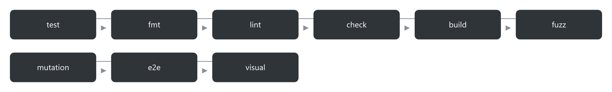

## licensing

Repository code is MIT. ref_ground/ ships GPL-3.0 derived data from blddb exports, the workbooks and TSV tables, and ref_ground/packs/ holds the 15 seed TSVs imported from cubing-trainer (MIT, with bld_3style_specials.tsv under the same blddb GPL carve-out) plus the 3 CFOP files authored here from J Perm pages. ref_doc/ is gitignored local grounding. DATA_PROVENANCE.md and ref_ground/packs/PROVENANCE.md record hashes, sources, and regeneration steps.
