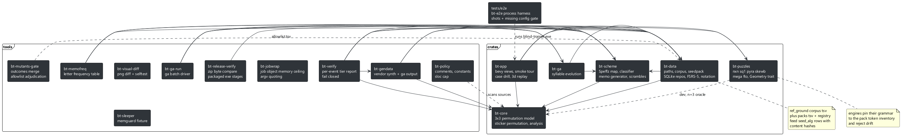
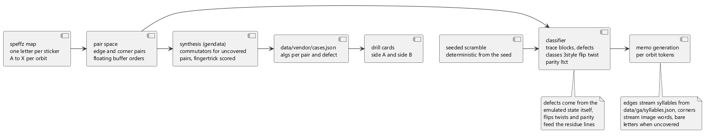
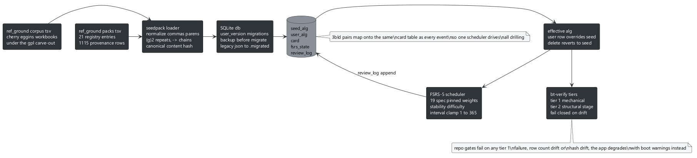
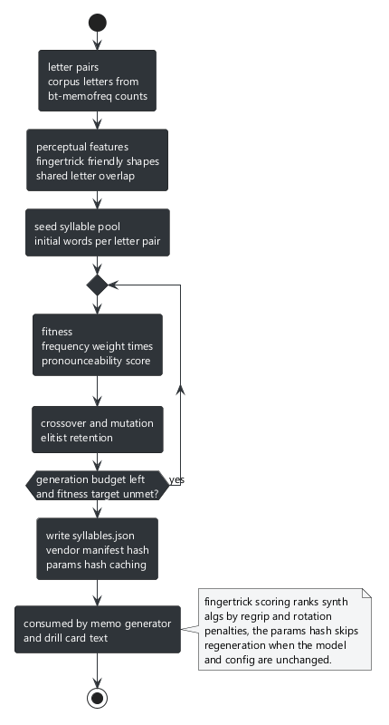
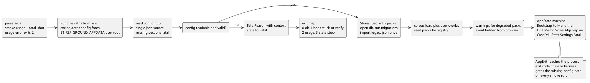
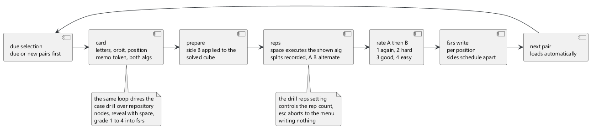
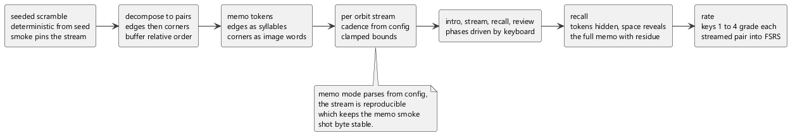
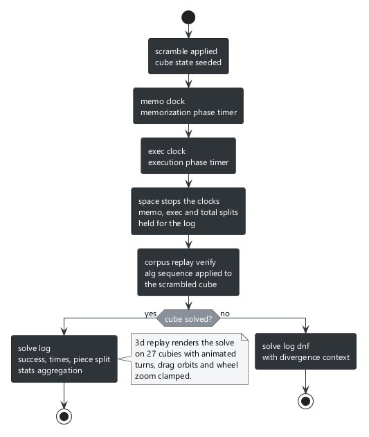
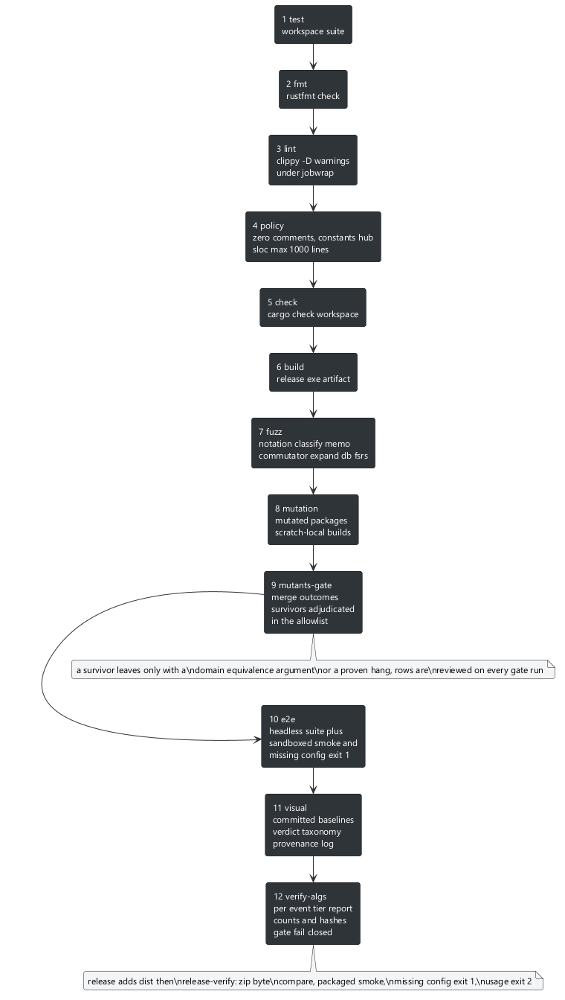

# blind-trainer

[](https://github.com/lavantien/blind-trainer/actions/workflows/ci.yml)
[](scripts/coverage-badge.ps1)
[](scripts/alg-coverage-badge.ps1)

A desktop 3BLD trainer: 3-style drilling, memo training, and timed solves, plus a multi-event alg repository covering CFOP, OH, 2x2, big cubes 4x4 to 7x7, pyraminx, megaminx, skewb, square-1, and FTO, every case drilled under the same FSRS-5 scheduler. Every alg is mechanically verified against an emulated cube or its own event engine, so misspellings and wrong algs never contaminate muscle memory. Alg data is the reconstructed Tommy Cherry and Charlie Eggins sets plus seed packs, sha-256 pinned under ref_ground/.

## Table of contents

1. [Pictures](#pictures)
2. [Data and formats](#data-and-formats)
3. [Architecture and flows](#architecture-and-flows)
4. [Local development](#local-development)
5. [Runtime data and config](#runtime-data-and-config)
6. [Surfaces](#surfaces)
7. [QA harness](#qa-harness)
8. [Licensing](#licensing)

## Pictures

1. 

   the menu, digits 1 to 6 open the views, boot warnings in the header strip

2. 

   the drill card, buffer and both targets highlighted on the net, side A colored by mechanic, side B held in the prepare line

3. 

   the rep phase, the net mirrors the prepared cube, space executes each side and flips A and B

4. 

   side A rating, 1 to 4 grade again, hard, good, easy

5. 

   the second rating prompt, for side B

6. 

   memo intro, seed, pair count, mode and cadence

7. 

   mid stream, the focal token over the muted previous tokens with the stream counter

8. 

   the recall prompt, every token hidden

9. 

   the full memo with residue lines for parity, flips and twists

10. 

    the solve ready screen, scramble seed and pair count

11. 

    the memo phase, timer with the stream counter

12. 

    the execution phase

13. 

    the result with memo, exec and total splits

14. 

    the alg browser, the 3BLD letters plus one arm per event

15. 

    the list filtered to the b prefix with the selection moved

16. 

    a repository case drill card after space reveals it

17. 

    case drill grading, keys 1 to 4

18. 

    the stats grid over the solve log and both card stores

19. 

    settings, memo cadence, memo mode, drill reps

20. 

    the fatal screen, shown instead of the menu when the config or the vendor sheets are unreadable

## Data and formats

### letter scheme, colors, buffers

Speffz letter scheme, one letter per sticker position per orbit, A through X:

```
edges   A UB  B UR  C UF  D UL  E LU  F LF  G LD  H LB
        I FU  J FR  K FD  L FL  M RU  N RB  O RD  P RF
        Q BU  R BL  S BD  T BR  U DF  V DR  W DB  X DL
corners A UBL B UBR C UFR D UFL E LUB F LUF G LDF H LDB
        I FUL J FUR K FDR L FDL M RUF N RUB O RDB P RDF
        Q BUR R BUL S BDL T BDR U DFL V DFR W DBR X DBL
```

The full map is equality-tested against ref_ground/position_map.tsv. Colors: white up, green front, red right, blue back, orange left, yellow down. The net lays out U on top, L F R B across the middle band with F centered, D at the bottom, faces identified by color. Every face plate carries a frame outline and every sticker a thin stroke whose ink is picked by luminance against the sticker color, so faces and stickers read clearly through the buffer and target highlights. Buffers: edge buffer UF, corner buffer UFR, both letter C. When the buffer piece itself gets displaced the buffer floats: edges follow UF UB UR UL FR FL DF DB DR DL BR BL, corners follow UFR UFL UBR UBL DFR DFL DBR DBL.

### memo tokens

Edge pairs memo as single Vietnamese syllables from data/ga/syllables.json, one syllable per pair, assigned by the genetic optimizer under memo-frequency weighting, make ga regenerates the assignment. Corner pairs memo as image words from the letter-pair image table embedded in bt-app, AB is Anthony Brooks, QM is Quail Man, pairs without an entry fall back to the bare letters. The memo mode setting picks the stream: syllables, images, or per-orbit, the default, syllables for edges and image words for corners.

### synthesis

Pairs with no vendor alg get a synthesized commutator from bt-gendata. Candidates are scored for fingertrick feel: move count, a penalty for turns outside the preferred face set, regrip count, and per-face finger costs that price each turn by direction, every weight a knob in the synth.scoring hub section. The search stops at the first setup depth that produces a hit and ranks only candidates at or under that length plateau. Regeneration short-circuits when nothing changed: a sha over the synth parameters, the corpus digest, and a generator version token skips synthesis outright.

### scheduling

FSRS-5 spaced repetition schedules every drilled position separately. Ratings 1 to 4 map to again, hard, good, easy, stability and difficulty follow the pinned py-fsrs reference math, intervals clamp to configurable bounds. The weights default to the reference release and live in srs.fsrs with the request retention, golden vectors generated from the py-fsrs reference pin the math under ref_ground/fsrs, and the fuzz fsrs target walks the scheduler. Legacy SM-2 history migrated by deterministic replay when the ease column was dropped.

### cube model

Faces in order U L F R B D, each a 2x2 sticker grid. Cube state is `occ: [u8; 54]` where occ[i] is the home sticker id currently at position i, the inverse state is the transpose, and solved means occ[i] == i for all i. The full letter to sticker map is equality-tested against ref_ground/position_map.tsv.

### notation

siGN dialect: faces U D L R F B with ' and 2, lowercase wides, inner slices 2U 2D 2L 2R 2F 2B, slices M E S, rotations x y z. M follows L, E follows D, S follows F. Rotation pins: z = F S B', x = R M' L', y = U E' D'. M2' canonicalizes to M2 because both produce the same permutation. Only face turns keep centers fixed, wides, inners, slices, and rotations move them, which is what makes centers_fixed a meaningful predicate. Every vendor alg in ref_ground is center-fixed by cancellation.

### execution model

3-style with floating-buffer sticker-following execution. Edge buffer UF, corner buffer UFR, floating orders listed under the letter scheme. A case written A-B-C cycles sticker A to B, B to C, C to A, verified on every vendor 3-style row. The first position token of a vendor alg names the floating buffer the alg starts from, which is how later memo pairs execute at non-UF/UFR buffers: memo generation records each pair's floating buffer head, and the ideal cycle check takes that buffer as an argument. Defects: which pieces an alg flips or twists is read from the simcheck notes produced by the independent pysim simulator, never inferred from position tokens, and the classifier cross-check pins the derived defects in agreement with those notes on every row that carries them.

### event engines and pack verification

Every non-3BLD event runs on its own engine in bt-puzzles: nxn handles 2x2 through 7x7 under one stride-based model, sq1 carries the exact square-1 geometry with the state-aware slash, mega the 5-sided ring under the pack's pinned grammar, pyra the regs 12e facelet model, skewb the corner-on turn tables, fto all 8 faces of the octahedron. Each engine parses its event's notation dialect and applies moves to its own state, one module per event behind one shared geometry interface.

Pack rows verify under a two tier model. Tier 1 round trips the row's alg against its inverse from solved in both orders through its event engine, so tokens that do not parse, sequences that do not execute, and wrong algs all fail closed. Tier 2 checks an independent predicate over the resulting state where an honest one exists, the sq1 cubeshape rows compare against the canonical shape classifier and the bld oldpoch rows against a piece audit, and prints a skip reason where none exists, prose algs and letter scheme rows. Known source defects stay verbatim on the expected-failure table in bt-data with per-row reasons, the probes that ruled out repairable explanations are pinned as evidence tests, and the rulings live in ref_ground/packs/PROVENANCE.md. make verify-algs fails on any unruled failure, any ruled row that fails nothing (a stale ruling), and any row-count drift against the registry pins.

## Architecture and flows



the workspace overview, solid arrows are crate dependencies, dashed arrows are dev, file and process relations


the bt-core pipeline, alg text through Move tokens into permutation analysis, rejects carry token context



the bt-scheme pipeline, Speffz map through the classifier, synthesis for uncovered pairs, memo generation, seeded scrambles



the bt-data pipeline, ref_ground corpus and packs through the loader into the SQLite stores and FSRS-5



the bt-ga pipeline, letter pairs through evolution into syllables.json



the app boot sequence, args and runtime roots through the config hub and the stores into the state machine, or the fatal screen



the drill flow, due selection through card, reps and rating into FSRS, the same loop drives the case drill



the memo flow, seeded scramble through pairs and memo words into the stream phases



the solve flow, scramble through the memo and exec clocks, corpus replay verification, the solve log



the verification chain, every gate from test to verify-algs, release adds dist and release-verify

## Local development

Prerequisites: a stable Rust toolchain with rustfmt and clippy (`make setup` installs the components), GNU make with pwsh.exe (PowerShell 7) on PATH since the Makefile drives every step through it, java for the diagrams, python for the simcheck script, and for the full chain cargo-fuzz with a nightly MSVC toolchain plus cargo-mutants. `make setup` reports which of the two are present.

1. Clone and build:

```sh
git clone https://github.com/lavantien/blind-trainer
cd blind-trainer
make setup
make build
```

`make build` emits `target/release/blind-trainer.exe`. The bevy facade pins the custom_cursor feature alongside bevy_feathers, without it bevy_winit fails to build from feature skew.

2. Generate the vendor data:

```sh
make gen-data
```

bt-gendata builds `data/vendor` from `ref_ground/` and synthesizes verified commutator algs for every uncovered pair. Synthesis short-circuits when a sha over the synth parameters, the corpus digest and a generator version token is unchanged. `make synth-simcheck` runs the independent pysim simulator over the synthesized algs and writes the simcheck notes the corpus defect reads come from.

3. Run the app:

```sh
make run
```

The first run creates `blind-trainer.db` in the user dir, imports legacy JSON files once, and runs the numbered migrations. A missing vendor directory only warns, the app runs on user data alone.

4. Regenerate artifacts:

```sh
make screenshots
make diagrams
make coverage
make alg-coverage
```

`make screenshots` rebuilds the gallery from a sandboxed run of the app, `make diagrams` re-renders every png from its puml source with the pinned plantuml jar.

## Runtime data and config

1. User data. `blind-trainer.db`, a SQLite database in the user dir: `%APPDATA%/blind-trainer` on Windows, `~/.local/share/blind-trainer` otherwise (`$XDG_DATA_HOME/blind-trainer` when the variable is set). Schema changes run as numbered migrations from `db/migrations/`, each step copies the database to a `.bak` backup first, and legacy JSON files (settings, srs, solves, user alg overlay) import once on first run and rename to `.migrated`.

2. Config hub. `config/config.json` is the single centralized source for every tunable: the app section (window, memo cadence and mode, drill reps, smoke seed, the app.replay playback and camera knobs), ga seed and weights, memofreq sampling, srs.fsrs (the FSRS-5 weights, request retention, interval clamp), verify limits, synth including synth.scoring (preferred faces, finger costs, ranking weights), visual tolerance, fuzz budgets, policy scanner settings, the memguard cap, the disk floor and scratch staleness window, the e2e shot list and timeout, the release verifier contract, and all paths including paths.packs. `make policy` enforces the hub: numeric literals recurring in src outside the hub must carry a justified row in `tools/bt-policy/constants_allow.txt`.

3. Environment overrides, the complete set the binaries honor:

| variable | shape | overrides |
|---|---|---|
| BT_REF_GROUND | path | ref_ground root the corpus and packs load from |
| BT_CONFIG | path | config hub path |
| BT_ARTIFACTS | path | artifacts root |

The Makefile exports them to every target. Runtime roots for config, vendor data and assets resolve from the workspace layout first and fall back to an exe-relative install layout when the workspace paths are missing, assets load through an absolute AssetPlugin file_path built at startup.

## Surfaces

### the app keyboard

blind-trainer.exe with no flags opens the menu. Exactly one of the shot flags may be set and each takes the output directory, a violation exits 2.

| flag | argument | purpose |
|---|---|---|
| --smoke | dir | run the smoke tour, assert the shot list and window dims, exit with the tour verdict |
| --usage | dir | write the usage screenshots |
| --fatal-shot | dir | write the fatal screen with the config pointed at a missing path |

The menu: digits 1 to 6 open the views. Every row shows the view name with a one-line description, boot warnings such as a missing vendor directory appear in the header strip. esc returns to the menu from every view and first drops any focused text input.

The drill view runs physical 3-style pair drilling with FSRS-5 scheduling, no typed input anywhere. The card shows the pair letters, orbit and position, the memo token (edges use the Vietnamese syllable, corners the image word, bare letters when uncovered), the side A alg colored by mechanic with setup muted, insertion teal, interchange orange, falling back to the raw commutator when it does not decompose, the prepare line holding side B, the vendor alg of the flipped case or the derived inverse labeled inverse, plus qtm and htm lengths, solver, verified badge, FSRS due for both sides, and muted alternative vendor rows. Apply prepare to your solved cube, space starts the rep phase: each space executes the shown alg, records a split and flips to the other side, alternating A and B until the even rep count ends back in the prepared state, the drill reps setting controls it. The timer shows whole seconds. Rate AB then BA with 1 to 4 (again, hard, good, easy), each rating writes FSRS for its own position and the next covered pair loads automatically, due or new pairs first. esc aborts to the menu writing nothing.

The memo view runs streaming memo on seeded scrambles with per-orbit tokens by default: edges stream Vietnamese syllables, corners stream image words, both fall back to the bare letters. Intro shows the seed, pair count, mode and cadence, space starts the stream. The current token renders focal with the 4 previous tokens muted below it and a stream counter. When the stream ends the app asks you to recall with no tokens shown, space reveals the full memo with its residue lines (parity, flips, twists). r replays the stream, 1 to 4 rate every streamed pair into FSRS, space moves to the next scramble.

The solve view is the timed full cycle with the net on the left and a rail on the right. Ready shows the scramble seed and pair count, space starts the memo clock and the token stream with a focal counter, space again switches to execution, space stops everything. The app replays your memo against the vendor corpus on the emulated cube, reports solved or failed with the broken pairs, and logs the record with memo, exec and total splits. space starts the next scramble.

The replay view: v at the solve review replays your solve as an animated 3d cube, the executed memo sequence turning on the scramble. Hold any mouse button and drag to orbit, the wheel zooms, r resets the camera, space pauses and resumes playback, v returns to the solve. Playback speed and the camera defaults and clamps live in the app.replay config section.

The algs view is a two-column browser over the full 3-style pair space plus the multi-event repository: the windowed list sits left, the selected case right. The list starts at the 3BLD letters, then one arm per event from the seed registry: 2x2, skewb, pyraminx, megaminx, square-1, big cube split by size 4x4 to 7x7, FTO, 3BLD, 3x3, and OH, each nesting method, stage, then cases from its seeded pack. An event whose pack fails to load hides with a boot warning instead of breaking the catalog. At the letters, slash focuses the filter and typed letters filter by pair prefix. Up down and n p move the selection everywhere, right descends into a repository node, left ascends, d or enter sends a 3BLD case to the drill or arms the case drill at a repository node, esc drops the filter focus first and exits the view on the second press. The 3BLD detail shows the letters, orbit, position and coverage, the first vendor alg colored by mechanic when its commutator decomposes, alternative algs, solver, qtm and htm lengths, a verification badge, and recon and video links. A repository case shows its event, method, stage, the net rendered through that event's engine, the seed alg with a seed or override badge, and a tier 1 verification line. o opens an override draft prefilled with the effective alg, enter submits it through the event's tier 1 verifier so a broken override never lands, tab cancels, x deletes the override and reverts to the seed.

The case drill view: d at a repository node arms a due session over every case under that node, d at a case node drills that single case. The session orders due and new cards first, space reveals the case, 1 to 4 grade again, hard, good, easy into FSRS with the case card repo, and the next card loads automatically until the queue empties and returns to the browser. esc exits to the menu at any time. 3BLD keeps its own drill view, the case drill serves every other event.

The stats view is a block grid over the solve log and both card stores: solve count, trailing streak of successful reviews, memo and exec mean and median, due counts per orbit for 3BLD, and a due count per event that holds case cards, so the session load reads at a glance.

The settings view holds memo cadence, memo mode (syllables, images, or per-orbit, the default), and drill reps. The number inputs and the select apply immediately, 1 2 and 3 switch the memo mode from the keyboard when no input is focused, everything persists across restarts.

The fatal screen: if the config cannot be read, or the vendor directory exists but its sheets are unreadable, the app opens here with the reason instead of the menu. A missing vendor directory only warns at the menu and the app runs on user data alone. The fatal screen ignores keys, fix the reported path and restart.

### make targets

`make help` prints this table from the Makefile target docs:

```text
help                     show this help
setup                    ensure rustfmt and clippy, report cargo-fuzz and cargo-mutants
docs-fetch               snapshot reference docs into ref_doc/
gen-data                 build data/vendor from ref_ground and synthesize uncovered pairs
verify-algs              verify every vendor alg and pack row, write the report
verify-algs-selftest     the bt-verify unit suite with planted offenders
synth-simcheck           run the independent pysim simulator over synthesized algs
memofreq                 memo pair frequency monte carlo
ga                       run the syllable optimizer into data/ga/
fmt                      rustfmt check over the workspace
fmt-fix                  rustfmt in place
lint                     clippy -D warnings under jobwrap
policy                   policy selftest then the zero-comment and constants-hub scan
policy-selftest          prove bt-policy detects comments and constants
check                    cargo check the workspace
build                    release build of blind-trainer.exe
jobwrap                  build the jobwrap memory anchor exe
test                     workspace test suite under jobwrap
test-crate               one crate's tests: make test-crate p=<crate>
mutants-gate             adjudicate mutation survivors against the allowlist
mutants-gate-selftest    the bt-mutants-gate unit suite
fuzz                     run every cargo-fuzz target under asan
mutation                 cargo mutants jobs 1 over the mutated crates
mutation-pkg             one crate's mutants: make mutation-pkg p=<crate>
mutation-merge           merge per-package outcomes for the gate
e2e                      headless flow suite then the smoke tour
e2e-smoke                sandboxed smoke tour over the release exe
visual                   visual selftest then the diff with one re-render retry
visual-diff              diff e2e shots against the committed baselines
visual-selftest          prove the diff passes identical and catches drift
baselines                copy e2e pngs into the committed baselines
screenshots              regenerate every usage shot and the fatal screen
memguard                 report repo process memory against the cap
memguard-selftest        prove the memguard matcher with a sleeper
clean-rust               size regenerable caches against the disk floor
clean-rust-apply         delete the sized caches
clean-rust-deep-apply    deep clean the e2e and fuzz targets
clean-rust-selftest      prove stale scratch selection
run                      run the app
chain                    the full verification chain, one make call per step
coverage                 llvm-cov run and coverage badge refresh
alg-coverage             alg coverage badge refresh
diagrams                 render every diagram png from its puml source
release-verify           byte-check the dist zip and run the packaged exe
release-verify-selftest  the bt-release-verify unit suite
dist                     build, stage and verify the dist zip: make dist v=<tag>
release                  push, tag and publish the github release
clean                    remove artifacts and the e2e target
```

### exit codes

blind-trainer.exe in smoke mode: 0 tour complete with all shots written, 1 verification failure or boot stuck past the limit, 2 CLI usage error, 3 a tour state never arrived. make visual: 0 clean, 2 regression on both diffs, 3 infra flake that passed the re-render, 4 infra error where the re-render itself failed. bt-visual-diff: 0 match, 1 mismatch or missing baseline, 2 usage. bt-e2e: 0 all shots verified, 1 shot failures, 2 harness error. memguard: 0 within cap, 2 usage or config error, 3 cap breach, 4 selftest fixture missing, 5 kill or assertion failure. bt-policy, bt-mutants-gate, bt-release-verify: 0 pass, 1 findings, 2 usage or harness error.

## QA harness

The verification chain runs through make in order, committing at each green step: test, fmt, lint, policy, check, build, fuzz, mutation, mutants-gate, e2e, visual, verify-algs, each as a separate make invocation under `make chain` so a failure names its step. visual always diffs fresh e2e renders against the committed baselines, baselines is never a chain leg. Every custom verifier ships a selftest target that proves it detects what it claims: policy-selftest, visual-selftest, mutants-gate-selftest, verify-algs-selftest, memguard-selftest, clean-rust-selftest, release-verify-selftest. Surviving mutants are never ignored: mutants-gate fails unless each one matches a justified row in tools/bt-mutants-gate/allowlist.tsv, stale rows also fail. Baselines carry their capture recipe in tests/visual/baselines/PROVENANCE.md. Adversarial review by two independent agents before any task closes, records land in docs/reviews/ from the template there. Baseline-first TDD per milestone, property-based invariants where they pay off. Conventional commits, zero code comments, the sloc cap. CI on every main push and pull request runs fmt, clippy, policy, check, the release build, and the self-contained test subset on GitHub Actions, everything heavier runs on the make chain.

## Licensing

Repository code is MIT. ref_ground/ ships GPL-3.0 derived data from blddb exports, the workbooks and TSV tables, and ref_ground/packs/ holds the seed TSVs imported from cubing-trainer (MIT, with bld_3style_specials.tsv under the same blddb GPL carve-out) plus the CFOP files authored here from J Perm pages. ref_doc/ is gitignored local grounding. DATA_PROVENANCE.md and ref_ground/packs/PROVENANCE.md record hashes, sources, and regeneration steps.
